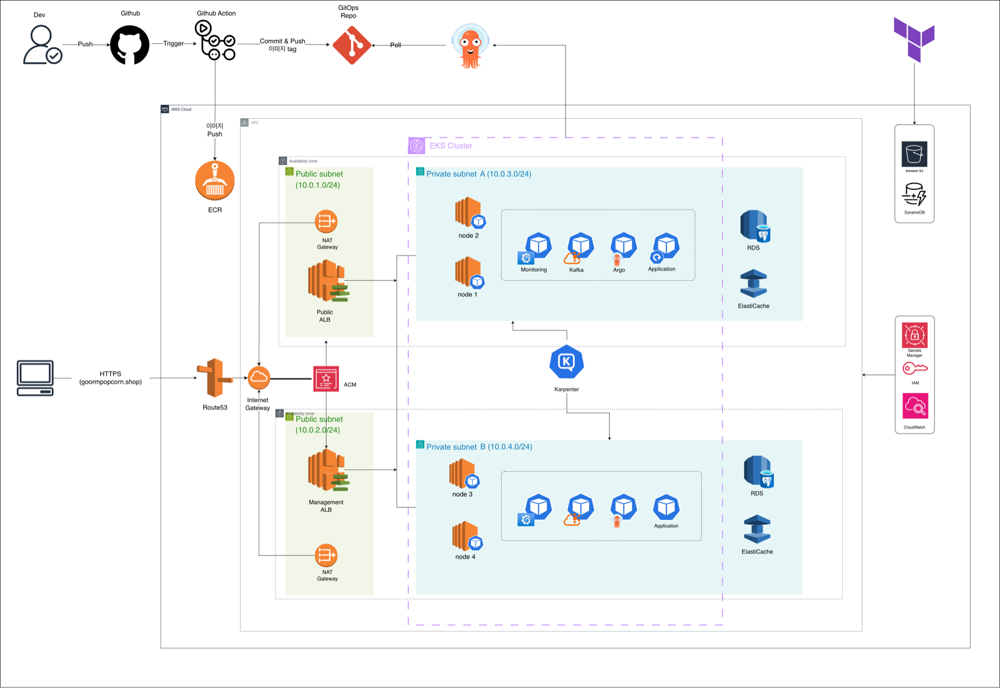
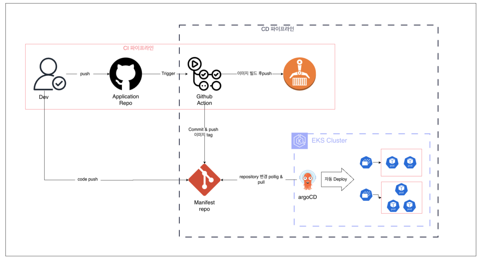
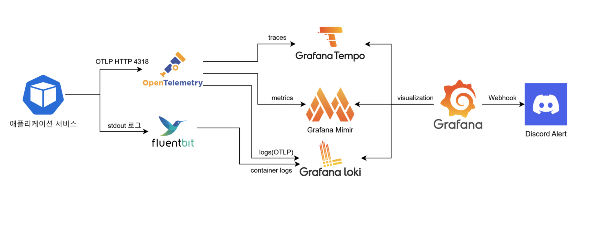
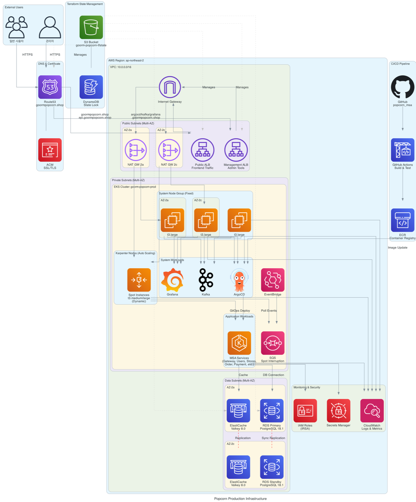
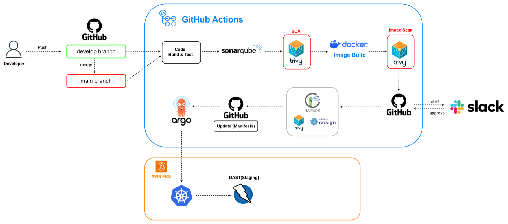
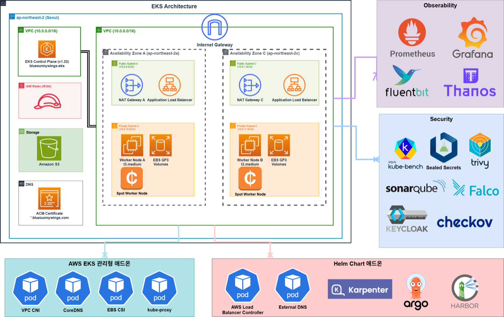

# 이준범 · Infra / DevOps / SRE

EKS 위 9개 MSA 서비스의 배포·관측·장애 대응을 맡아, 팀 배포 저장소 커밋의 83%를 작성한 인프라 엔지니어입니다.
장애가 나면 지표와 로그로 원인을 좁혀 복구하고, 그 과정을 문서로 남깁니다.

📮 june406v@gmail.com · AWS Certified Solutions Architect – Associate

```
Kubernetes  EKS · Karpenter · Helm · ArgoCD · Argo Rollouts
IaC / AWS   Terraform · VPC · EKS · RDS · ElastiCache · ALB · Route53 · IAM(IRSA)
관측성       OpenTelemetry · Grafana LGTM(Loki·Tempo·Mimir) · Prometheus · Fluent Bit
DevSecOps   GitHub Actions · Checkov · Trivy · kube-bench · Keycloak · External Secrets
성능·DB      k6 · HikariCP · PostgreSQL 실행 계획 분석
```

---

## 🍿 Popcorn — EKS 기반 MSA 배포·운영 플랫폼
`2025.12 ~ 2026.02` · 6인 팀 · 인프라·배포 설계 주도

팝업스토어 예약·주문·결제·QR 체크인 커머스 (Spring Boot 9개 서비스, Kafka 이벤트 기반)

| 저장소 | 내용 |
|---|---|
| [popcorn-terraform](https://github.com/ProfectProject/popcorn-terraform) | VPC·EKS·RDS·ElastiCache·ALB·IAM Terraform 모듈 (dev/prod 분리) |
| [popcorn_deploy](https://github.com/ProfectProject/popcorn_deploy) | Helm common + umbrella 차트, ArgoCD, Karpenter, LGTM·OTel, ESO |
| [popcorn_msa](https://github.com/ProfectProject/popcorn_msa) | 애플리케이션 코드 |



<details>
<summary><b>GitOps CI/CD · 관측성 파이프라인 · 리소스 상세 아키텍처</b></summary>




</details>

📄 설계 문서: [인프라 설계서](https://github.com/ProfectProject/popcorn-terraform/blob/HEAD/docs/ARCHITECTURE.md) · [설계·운영 문서 모음](https://github.com/ProfectProject/popcorn_deploy#인프라-설계운영-문서) · [장애 기록 7건](https://github.com/ProfectProject/popcorn_deploy/blob/main/design/troubleshooting/INCIDENT_REPORTS.md)

**내가 한 일**
- ECS → EKS 전환을 설계하고 인프라·배포 설계서를 작성. 서비스용(WAF)·관리용(IP 화이트리스트) ALB 분리, 비용 기준으로 Kafka는 MSK 대신 EKS KRaft 채택
- 9개 서비스 Helm 차트를 common + umbrella로 표준화. ArgoCD dev·prod 배포, Argo Rollouts Blue-Green을 전 서비스에 적용
- Terraform EKS 모듈에 Karpenter(Spot 중단 처리 SQS·EventBridge) 구성, Spot/On-Demand 혼합 NodePool
- OTel Java Agent·Fluent Bit·LGTM과 알림 규칙 8개 → 가동 2.5일 동안 Firing 96건, SLO 알림 해소 중앙값 5분
- GitOps 배포 저장소 사람 커밋 68/82건 (83%)

**문제 해결**
| 문제 | 원인 → 조치 |
|---|---|
| 검색 API 300 RPS p95 44.7s, 실패율 6.7% *(로컬 재현)* | 공통 `DataSourceConfig`가 Hikari 설정을 바인딩하지 않아 튜닝이 전부 무시되고 있었음. 고쳐 보니 병목은 DB CPU였고, `ILIKE` 전체 스캔에 pg_trgm 인덱스 추가 → **p95 6.3ms, 실패율 0%** |
| Kafka 컨트롤러 OOMKilled | limits 512Mi에 힙 75% → limits 2Gi, `MaxRAMPercentage=50` |
| Debezium CDC 커넥터 FAILED | 권한 누락 + `rds.logical_replication` pending-reboot → 권한 정리·재부팅, bootstrap Job으로 커넥터 등록 자동화 |
| ArgoCD 이미지 태그 드리프트 | `values-prod.yaml`의 `tag` 키 중복 → 제거 |
| 비용 급증 | CloudTrail로 콘솔에서 만든 MSK Serverless를 원인으로 특정 → 예산 $340 안에서 운영, 종료 후 리소스 12개 유형 0건 확인 |

---

## 🔐 div4u — DevSecOps 운영 자동화
`2025.07 ~ 2025.08` · 4인 팀 · 인프라·보안 자동화 담당 · 🏆 최종 프로젝트 발표회 우수상

서울시 실시간 혼잡도 서비스를 EKS에 배포하고, PR 단계부터 런타임까지 보안 점검을 자동화한 프로젝트

[k8s-OSS](https://github.com/CCCR-div4u/k8s-OSS) (보안 점검 자동화 · 내 작업) · [div4u](https://github.com/CCCR-div4u/div4u) (팀 앱)

<details>
<summary><b>CI/CD 보안 파이프라인 · EKS 구성</b></summary>



</details>

- 12개 컴포넌트 Helm 차트를 렌더링해 Checkov로 검사, 변경된 컴포넌트만 스캔해 GitHub Issue·Slack으로 알림
- kube-bench를 노드별 Job으로 매일 실행 → S3 저장 → GitHub Issue·Slack 리포트, Kagent remediator가 조치 방안 제시
- Keycloak OIDC로 Argo CD·Harbor 로그인 통합

---

## 그 외
- **Kubernetes Cluster Security Scanner** (2023, 3인): Terraform EKS. kube-bench DaemonSet은 `restartPolicy: Always` 제약 때문에 결과를 수집할 수 없어 노드별 Job으로 다시 설계
- **추천 모델 파이프라인** (2025, 6인, 장려상): EKS + Kubeflow + KServe로 LightFM 모델 서빙 · [sesac](https://github.com/CyberBoarder/sesac)
- **업무 자동화** (2026, 경복대학교 AID사업단): 설계 문서를 먼저 쓰고 Claude Code로 Apps Script 예약 웹앱 구현 (LockService 동시성 제어, 캐시로 API 호출 15→2회)
